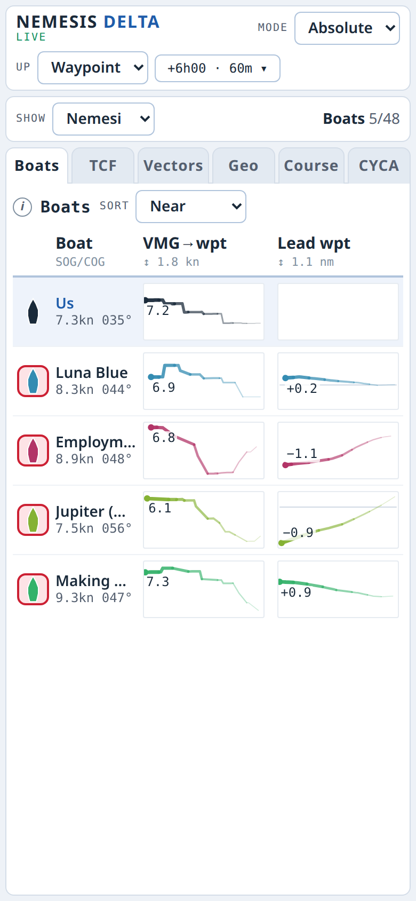
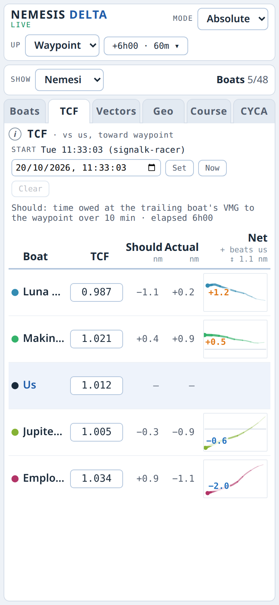
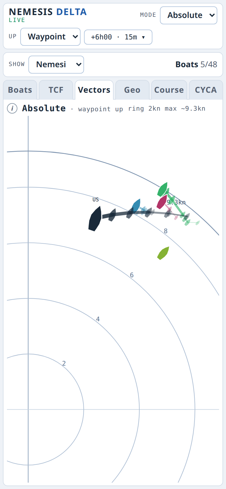
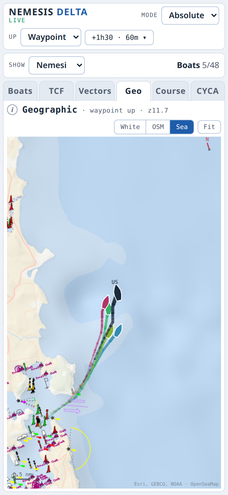

# Nemesis Delta (signalk-nemesis)

A Signal K plugin and webapp that shows how nearby competitors (your nemesis boats) are
sailing relative to you during a race. It answers three questions: who is going faster
toward where we are heading, who is gaining or losing on us, and who is beating us on
handicap. It works from AIS, and for CYCA races it can add the CYCA race tracker for boats
out of AIS range.

| Boats | TCF | Vectors | Geo |
| --- | --- | --- | --- |
|  |  |  |  |

Six hours into the 2026 Sydney Gold Coast race, from recorded AIS data.

Demo video: [Nemesis Delta on YouTube](https://youtu.be/OIuWYOKStu0).

## Install

In the Signal K admin UI: **Appstore > Available**, find **Nemesis Delta**, **Install**, then
restart the server. Then **Server > Plugin Config > Nemesis Delta**: enable it, and
optionally enter your nemesis boats in advance (MMSI, name, TCF).

The plugin needs Node 22 or newer; the server's Node version is shown at the bottom of the
admin UI. Without internet on the boat, see
[Installing from a package file](https://github.com/gregw/signalk-nemesis/wiki/Installing-from-a-package-file).

## Use

Open the webapp from **Webapps** in the admin UI, or at
`http://<boat computer>:3000/signalk-nemesis/`, on a phone, tablet or the nav PC. Every
screen shares the same nemesis list, TCFs and course, kept on the server.

Across the top:

- **Up**: what the charts measure toward. **Waypoint** (the active waypoint from the chart
  plotter or nav PC), **Course** (the marks set on the Course tab), **COG**, **North**, or
  **Upwind** / **Downwind** (into or away from our true wind direction, smoothed over 2
  minutes).
- **Mode**: **Absolute**, or **Relative** to us.
- **Time**: live, or step back through the race, and the period the charts show.
- **Show**: which boats appear: nemeses only, sailing boats, all, those in range, or none.

The tabs (each has an **i** button that explains it):

- **Boats**: each boat's VMG and lead toward Up as strip charts. Tap a boat's icon to make it
  a nemesis.
- **TCF**: time-on-time handicap. Enter each boat's TCF and ours, and see who is beating us on
  corrected time. The race start comes from signalk-racer, or set it here.
- **Vectors**: every boat's speed and direction, with Up at the top.
- **Geo**: the boats on a map, with Up at the top. The OSM and Sea maps need internet. The
  **Course** box shows the course from the Course tab, and with true wind the **Wind** box
  shows a wind ladder: lines across the wind, in nm upwind of us.
- **Course**: the marks for Up = Course. Add waypoints made in your chart app, or import a
  route.
- **CYCA**: pick a CYCA race to add tracker positions every 10 minutes (needs internet), and
  link each tracker boat to its AIS boat so they show as one.

A boat not heard for a while (30 minutes by default) is greyed and its lines broken.

## More

The [wiki](https://github.com/gregw/signalk-nemesis/wiki) has every configuration option,
the plugin's interfaces, development and testing, and the project brief. Changes are in
[ReleaseNotes.md](ReleaseNotes.md).
